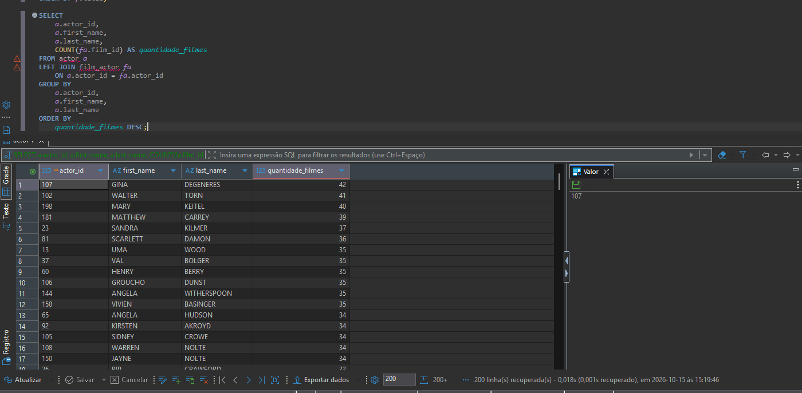
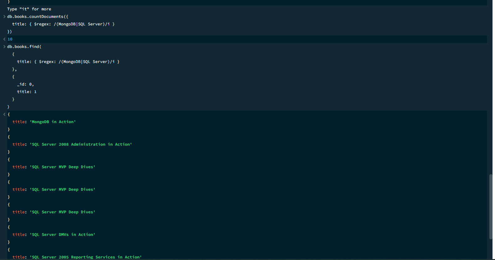
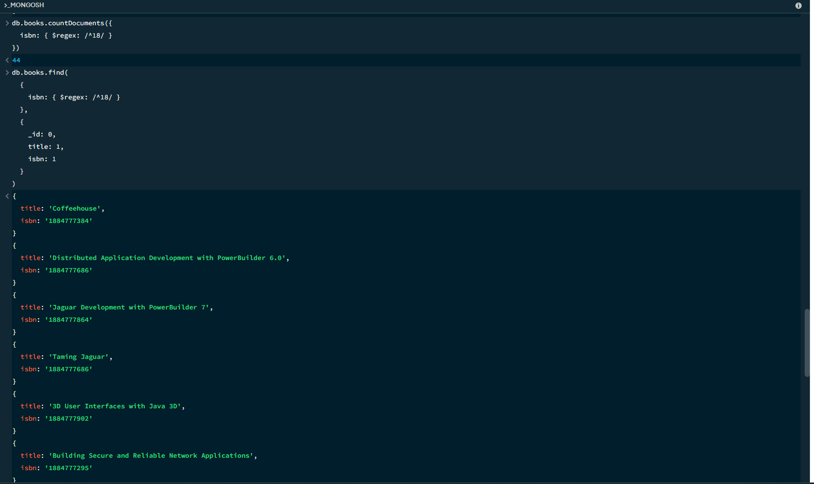

# Módulo 32 - Banco de Dados SQL/NoSQL

Exercício do módulo 32 do curso de Engenharia de Qualidade de Software da EBAC.

## Estrutura

### SQL

Consultas utilizando o banco Sakila:

- lista de filmes e suas categorias;
- lista de todos os atores e quantidade de filmes;
- atores que participaram de filmes com mais de 120 minutos;
- contagem dos resultados das consultas.

Arquivos:

- `SQL/exercicio_1.sql`
- `SQL/exercicio_2.sql`

#### Resultados obtidos

| Consulta | Resultado |
| --- | ---: |
| Filmes e categorias | 1.000 registros |
| Atores | 200 atores |
| Atores em filmes com mais de 120 minutos | 200 atores |

#### Evidências

**1. Filmes e categorias**

**2. Atores e quantidade de filmes**

**3. Atores em filmes com mais de 120 minutos**

### NoSQL

Consultas utilizando o banco `books.json` no MongoDB:

- livros não publicados com menos de 300 páginas;
- livros com MongoDB ou SQL Server no título;
- ISBN iniciado por 18;
- busca por JAVA ou Mobile na descrição;
- contagem dos resultados das buscas.

Arquivos:

- `NoSQL/exercicio_1.nosql`
- `NoSQL/exercicio_2.nosql`

#### Resultados obtidos

| Consulta | Resultado |
| --- | ---: |
| Não publicados com menos de 300 páginas | 64 livros |
| MongoDB ou SQL Server no título | 10 livros |
| ISBN iniciado por 18 | 44 livros |
| JAVA ou Mobile na descrição | 98 livros |

#### Evidências

**1. Não publicados com menos de 300 páginas**

**2. MongoDB ou SQL Server no título**

**3. ISBN iniciado por 18**

**4. JAVA ou Mobile na descrição**

## Branch

`main`
